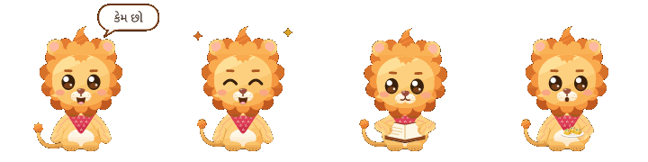

# Hi, I'm Radhe

  
  &nbsp;
  
  &nbsp;
  

I make games, apps, mods, and the occasional engineering experiment because I enjoy bringing ideas to life. Usually, a project starts with something I'd love to use, a world I'd like to spend time in, or a small problem that would be more fun to solve with a little imagination.

Building these projects has given me a reason to try unfamiliar tools, work through problems, and give more of my ideas a chance. Along the way, I've been learning the technical skills behind them: reading code, understanding how systems fit together, debugging, testing, and making better decisions about what a project actually needs.

The process itself is a big part of why I keep coming back. I like seeing a character come to life, finally understanding a bug, or getting a tiny detail to feel right. These projects are things I want to exist and enjoy spending my time on.

## How I build with AI

I use AI extensively in my workflow, from exploring an idea to building, debugging, and learning as I go. It's helped me bring projects I used to only daydream about into the world, and experimenting with how to work well with these tools has become something I enjoy in its own right.

- **Claude Code** is my main coding assistant, and I also use **Codex** across my projects.
- I've experimented with recent **DeepSeek** and **Qwen** models, exploring how different models fit different tasks.
- I've also experimented with **local models**, alongside the hosted tools I use day to day.

I'm developing practical AI engineering skills by improving the workflow itself: breaking tasks into clear steps, giving models useful project context, refining prompts and instructions, and building feedback loops around testing, code review, and debugging. I'm learning how to choose tools for the task, catch mistakes, and make the process more efficient and reliable. There's a lot I still want to understand, and my projects give me a reason to keep experimenting.

## A few things I've been making

  

- **[StudyMon](https://github.com/radhepa/StudyMon)** and **[Codew Valley](https://github.com/radhepa/Codew-Valley)** — learning through play. One turns C, calculus, and chemistry revision into a Pokémon-style adventure; the other lets you build a cozy 3D village by writing real Python.
- **[Gujju](https://github.com/radhepa/Gujju)** — a Gujarati learning app that starts with reading the script and grows into words, conversations, and stories. Language is personal to me, and I want learning it to feel welcoming.
- **[Katha](https://github.com/radhepa/Katha)** — a quiet place to read the Bhagavad Gita, Ramayana, and Mahabharata, with Sanskrit, transliteration, English, and guides to their stories and characters.
- **[Catching Days](https://github.com/radhepa/Catching-Days)** and **[FitPip](https://github.com/radhepa/FitPip)** — everyday tools with a little companionship: a living pond that grows as you get things done, and a fitness log with Pip cheering you on.
- **[Village Friends](https://github.com/radhepa/Village-Friends-Minecraft-Mod)** and my other **[Minecraft mods](https://github.com/radhepa?tab=repositories&q=friends)** — experiments with characters, friendships, creatures, and places that make a familiar world feel more alive.
- **[SpanishDict to Anki](https://github.com/radhepa/SpanishDictToAnki)** — a small browser extension that takes the repetitive work out of moving vocabulary into flashcards. Sometimes the satisfying project is the one that saves a few clicks.
- **[tinyspice](https://github.com/radhepa/tinyspice)**, **[li-ion-bms](https://github.com/radhepa/li-ion-bms)**, and **[sic-inverter-800v](https://github.com/radhepa/sic-inverter-800v)** — exploring circuits, numerical methods, embedded C, battery estimation, and power electronics through code, simulations, and schematic design.

## What I'm learning along the way

  
  &nbsp;
  
  &nbsp;
  

My projects have given me hands-on practice with **C, Python, Java, JavaScript, and TypeScript**; web and mobile apps with **React, React Native, and Expo**; and 3D worlds and assets with **Three.js and Blender**. I've also been working with local storage and database sync, browser extensions, Minecraft's Fabric tools, and engineering tools like **SPICE and KiCad**.

I'm learning to check my work, too: writing tests, trying the actual user experience, comparing simulations with reference results, and using Git to keep changes understandable. There's plenty I still want to learn, and having a project I care about gives me a reason to keep going.

I like making things that are kind to the person using them: room to make mistakes, encouragement to try again, and space for rest. If something here helps someone learn, makes an ordinary day a little easier, or simply makes them smile, I'm happy to have made it.

  
  
  
  
  

Thanks for stopping by. I hope you find something here that feels fun.
